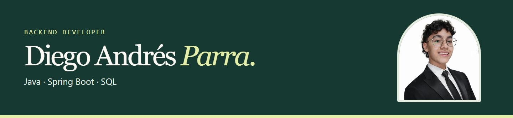

<a href="https://portfolio-one-wine-r6971y2s0u.vercel.app"><strong>Visit my portfolio</strong></a> &nbsp; · &nbsp; <a href="https://portfolio-one-wine-r6971y2s0u.vercel.app/cv_diego_parra.pdf">Download my résumé (Spanish)</a> &nbsp; · &nbsp; <a href="https://www.linkedin.com/in/diego-parra-6761a43a1/">Connect on LinkedIn</a>

## Hi, I'm Diego

I'm a backend developer from Floridablanca, Colombia. I studied software development at **Campuslands** and joined **Globant** as an intern in November 2026. The work featured here comes from my academic and personal projects.

My favorite way to understand a system is to follow one operation all the way through it. Take a flight reservation. A passenger chooses a flight, a service checks the remaining capacity, and the application either records the booking or explains why it can't. The most interesting test is the passenger who tries to book the seat *after* the last one.

## Featured project · NEXO

**Java 21 · Spring Boot · Spring Security · PostgreSQL**

NEXO is my academic adaptation of [Cristian Díaz's open-source template](https://github.com/CRISTIAN7712/Plantilla_Spring_Security). It brings users, roles and permissions into the same application as customers, purchases and sales. The web client adapts its menus to the signed-in user. The backend checks permissions when it receives a protected request.

| If you're interested in… | Start here |
| --- | --- |
| Running the application locally | [Setup, architecture and configuration](https://github.com/DiegoAndresParra14/Plantilla_Spring_Security) |
| Following a request through the backend | [Endpoints, authentication and permissions](https://github.com/DiegoAndresParra14/Plantilla_Spring_Security/blob/main/spring-security-user-role-management/README.md) |
| Seeing how behavior is checked | [JWT and HTTP tests](https://github.com/DiegoAndresParra14/Plantilla_Spring_Security/tree/main/spring-security-user-role-management/src/test) |

## Two business rules worth exploring

### What happens when a flight is full?

In my **Java 17 airport reservation system**, flights and passengers live in memory. The console lets you search by destination, make a reservation and inspect the passenger list. A regression test exercises a full flight, invalid capacity and recovery from nonnumeric menu input.

[Explore the Java application](https://github.com/DiegoAndresParra14/java_aeropuerto) · [Read the regression test](https://github.com/DiegoAndresParra14/java_aeropuerto/blob/main/tests/AirportRegressionTest.java)

### When does a coworking membership expire?

My **MySQL coworking schema** connects members, workspaces, bookings and billing. One rule belongs in the database itself. When a membership is inserted, a trigger sets its end date to 30 days after the start date. The accompanying SQL test inserts sample data, checks the result and rolls the transaction back.

[Read the schema](https://github.com/DiegoAndresParra14/examen_Diego_parra_mysql/blob/main/script.sql) · [Follow the expiry test](https://github.com/DiegoAndresParra14/examen_Diego_parra_mysql/blob/main/tests/membership_expiry.sql)

## Beyond the backend

I also enjoy building the interface someone uses to reach a service. My [movie and TV client](https://github.com/DiegoAndresParra14/APIS_JavaScript) explores working with an HTTP API in JavaScript. My [personal portfolio](https://github.com/DiegoAndresParra14/Portfolio) takes a different approach. Its projects, résumé and contact links work with plain HTML, while JavaScript adds filtering and email drafts.

A little more about me

Away from the keyboard, my listening habits range from Guns N’ Roses to *Back to Black* and *Serenata sin mariachis*. [Find me on Spotify](https://open.spotify.com/user/31chfkeemswcccr7bxwdcrfsowce).

If you'd like to talk about a backend opportunity or ask me about a decision in one of these projects, [send me a message on LinkedIn](https://www.linkedin.com/in/diego-parra-6761a43a1/).
